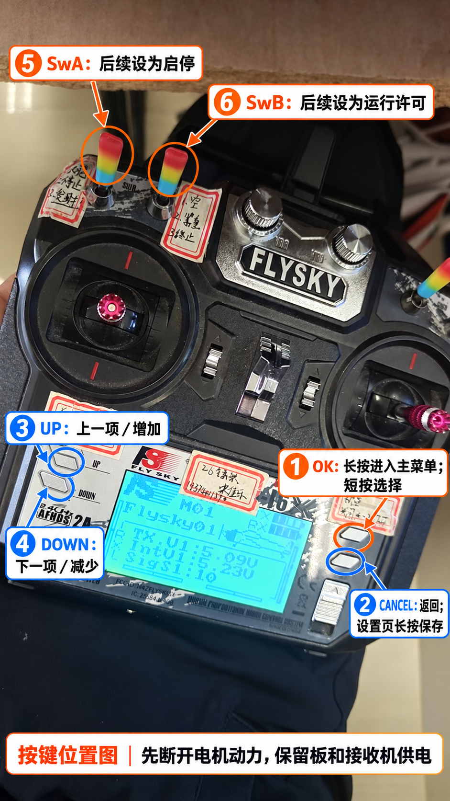

# FS-i6X 按键图与首次操作

按键位置已对照富斯官方 FS-i6X 使用说明书核对。批注由内置 imagegen 工具生成，用于寻找按键和开关；屏幕数据、贴纸与细节以用户原照片和实物为准，批注图不作为实测数据。



## 当前先做这一阶段

1. 断开 GM6020 动力电源，保留云台板和接收机供电。
2. 当前照片是主界面。长按图中① OK，直到主菜单出现，再松手；首次进菜单不是短按。
3. 主菜单通常显示 System setup（系统设置）与 Functions setup（功能设置）。先停在这里，再根据实际菜单继续设置。

已对频的迹象包括接收机 LED 稳定、主界面显示接收机电压；无线已连接仍需另外确认云台板 UART4 收到 i-BUS 通道。

## 按键与开关

| 图中编号 | 部件 | 用法 |
| --- | --- | --- |
| ① | OK，屏幕右侧上键 | 主界面长按进主菜单；菜单内短按选择/进入 |
| ② | CANCEL，屏幕右侧下键 | 返回；辅助开关、辅助通道和Failsafe设置页长按保存返回 |
| ③ | UP，屏幕左侧上键 | 上一项或增加数值 |
| ④ | DOWN，屏幕左侧下键 | 下一项或减少数值 |
| ⑤ | SwA，左肩外侧开关 | 后续在Aux channels中绑定CH5启停 |
| ⑥ | SwB，左肩内侧开关 | 后续绑定CH6运行许可 |

主菜单长按OK与设置页长按OK的含义不同：多个设置页长按OK是恢复默认，不要用它保存。开关的高低值及摇杆通道以VOFA观察为准，不能靠已有贴纸确定。

后续顺序为：核对10通道与开关启用 → CH5绑定SwA、CH6绑定SwB → 设置Failsafe → VOFA核对通道 → 低转速与失联停机验证。详细教程见[接线与考核操作步骤](富斯接线与考核操作步骤.md)。

## 原始依据

- [2025中文官方手册](../03_参考资料/FS-i6X_官方使用说明书_中文_20250228.pdf)：PDF第7页按键图，第8页电压状态，第15页辅助通道，第21页辅助开关，第22页Failsafe。
- [2016英文官方手册](../03_参考资料/FS-i6X_官方使用说明书_英文_20160817.pdf)：PDF第25页8.1明确长按OK打开主菜单。

## 图片生成说明

使用内置imagegen，编辑用户原照片后非覆盖保存。最终提示词如下。

<details>
<summary>查看最终批注提示词</summary>

```text
Use case: precise-object-edit. Edit target: the user's exact attached photograph of a FlySky FS-i6X remote transmitter. Create an accurate Chinese instructional annotated photo, keeping the original remote, LCD content, physical keys, switches, perspective, labels, colors and geometry unchanged. Only add clean numbered callouts and thin arrows/circles; do not replace or redraw the hardware. Use free areas at the top and bottom or expand neutral side margins for legible text, keeping the full original remote in view.

Source photograph is 1080x1920. Arrow targets are stated in ORIGINAL image coordinates and must stay anchored to the exact physical parts:
1: center (849,1280), the UPPER of two small silver menu buttons immediately RIGHT of the LCD: text exactly "① OK：长按进入主菜单；短按选择". Highlight this button most prominently in orange.
2: center (826,1344), the LOWER of those two small silver menu buttons to the RIGHT of LCD: text exactly "② CANCEL：返回；设置页长按保存". This is NOT the vertical ridged silver switch below it. Use blue.
3: center (155,1084), the UPPER small silver button LEFT of LCD, next to printed UP: text exactly "③ UP：上一项／增加".
4: center (132,1153), the LOWER small silver button LEFT of LCD, next to printed DOWN: text exactly "④ DOWN：下一项／减少".
5: center (260,390), the outer LEFT shoulder switch with rainbow rubber cover: text exactly "⑤ SwA：后续设为启停".
6: center (407,429), the inner LEFT shoulder switch with rainbow rubber cover nearest the two silver rotary knobs: text exactly "⑥ SwB：后续设为运行许可".

Use large legible simple Chinese characters with white pill or rectangular label backgrounds, restrained orange and blue annotation palette. Make arrow endpoints unambiguous; do not point at existing handwritten stickers. Do not label the right stick's channel, do not change screen or any physical parts. In a small footer add exactly "按键位置图｜先断开电机动力，保留板和接收机供电". No additional instructions or invented menus.
```

</details>

