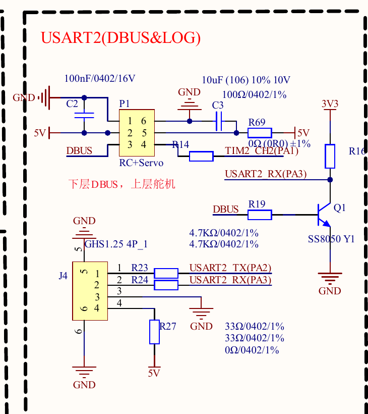
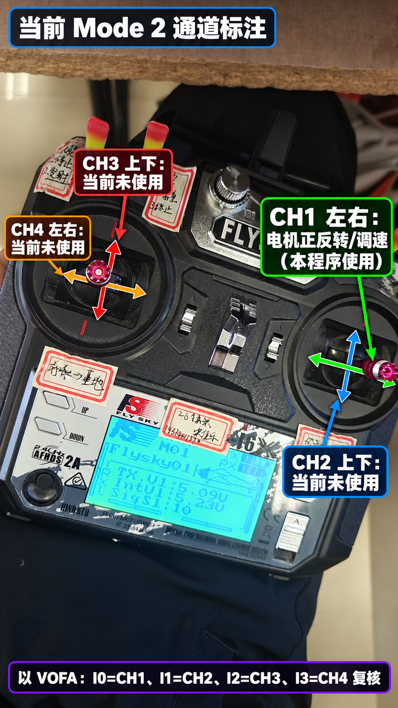

# 富斯接线与考核操作步骤

## 1. 先认识接收机和板上的六针接口

本次使用 FS-iA10B 的 **i-BUS SERVO**，它把多个遥控通道打包成一条串口数据流。`SENS` 用于传感器通信，普通 `CH1…CH10` 是单通道舵机输出，不能把任意通道当成 i-BUS 数据口。

电脑 VOFA 使用云台板 USART1，GM6020 ID1 使用 CAN1。本次接收机改接左上角六个裸露插针对应的 **P1 / RC+Servo 上层三针**，不再使用 USART6 插座。P1 是两组三针：原理图标注“下层 DBUS，上层舵机”，两个信号脚走不同电路。

“上层/下层”指原理图定义的连接器层，**不能理解成照片上边/下边**。硬件图 02 左上六针翻到背面，对应硬件图 01 右上六个焊盘；硬件图 01 左侧标着 `PWM/5V/GND` 的三针边缘接口是另一个接口，不能把它当成本次 P1 上层。脚位要按 P1 针号及实际电路核对，不能按线色、照片左右或“左数第几根”猜。

| P1 分组 | 原理图脚号 | 电气功能 | 本方案用途 |
| --- | --- | --- | --- |
| 下层 DBUS | 1 | GND | 不使用这一组三针 |
| 下层 DBUS | 2 | +5V | 不使用这一组三针 |
| 下层 DBUS | 3 | DBUS，经 Q1 反相后到 PA3 / USART2_RX | 不接 i-BUS 信号 |
| 上层舵机 | 4 | 经 R14 100Ω 到 PA1，原网络名 TIM2_CH2 | 接收机 i-BUS 信号输入；固件复用为 UART4_RX |
| 上层舵机 | 5 | 经 R69 0Ω 到板上 +5V | 给接收机供电，**不是 3.3V** |
| 上层舵机 | 6 | GND | 共地 |

下层 DBUS 的 Q1 会把信号反相。接收机普通 i-BUS 输出直接接 P1 pin3，不能被本方案的普通异步串口解析。本次保持接收机 i-BUS 输出，使用上层 pin4 的 PA1 直连路径，不需要外加反相器，也不切换为 S.BUS。

完整电路可对照 [云台板原理图](../03_参考资料/IMU_V4.7.4_BMI088_ICM42688.pdf) 第一页的 `USART2(DBUS&LOG)` 区域；局部图中的 `TIM2_CH2(PA1)` 是原理图网络名，不代表 PA1 只能用作定时器。

## 2. 三根线怎么接

先关闭板和接收机电源，再接线。

| FS-iA10B：i-BUS 的 SERVO 组三针 | 云台板 P1 上层 | 作用 |
| --- | --- | --- |
| 信号 S | pin4 | 接收机 i-BUS 输出 → R14 → PA1 / UART4_RX |
| 电源 + | pin5 | 板端提供 5V，给接收机供电 |
| 地 − | pin6 | 共地 |

可以使用三根合适的母头杜邦线分别连接，不需要占用板上的专用串口连接线。只接这三根线，不连接下层 pin1/2/3，也无需 UART4_TX。若使用整组三针插头，先确认其中的信号、正极和地与 pin4/5/6 一一对应，不能只凭插头能插进去就通电。

这里的 UART4 是主控内部串口外设名称；本次信号实际接在 **P1 pin4**，不是让你改接板上标着 USART4 的白色插座。

接收机标签标明供电 **3.5–9V DC**，本次用板端 **5V**；不要把电机动力电源接到接收机。接收机先不接，断电时用万用表通断档核对 pin6 与板上 GND 测试点连通；再给板供电，电压档确认 pin5 对 pin6 约为 5V。核对后断电，再接收机。通断档不要在电路通电时使用。

PA1 在 STM32F405 数字复用模式中属于 **FT（5V 容忍）** 引脚，迁移版将其设为 UART4_RX、`GPIO_NOPULL`，不启用 PA1 的 ADC 模拟模式；R14 100Ω 是串联电阻，不是电平转换器。ST 要求高于 VDD+0.3V 的输入关闭内部上下拉。[STM32F405/F407 官方数据手册](https://www.st.com/resource/en/datasheet/stm32f407vg.pdf)

板和接收机由板上 5V 同源供电、一起通断，避免板 MCU 未供电时接收机仍向 PA1 输出信号。本次接法不使用接收机的独立高压电源；接收机“可用 9V 供电”不能理解为 PA1 能接 9V 信号。

接收机 SERVO 插针的 +/−/信号排列以外壳标记为准；不要接到旁边的 SENS 组三针。天线/射频导线不作为信号线接到云台板。USART1 与 CAN1 维持用户现有连接。

## 3. 遥控器对频与模式

初次使用遥控器时，先看[按键批注图与首次操作](FS-i6X按键图与首次操作.md)：主界面长按OK进入主菜单，UP/DOWN选项、短OK进入；辅助通道及Failsafe设置后长CANCEL保存返回。

如果接收机已对频且遥控开机后接收机 LED 稳定常亮，可直接进入输出和通道设置。

未对频时，按 FS-i6X 官方说明操作：关闭设备，在接收机 B/VCC 插入原配对频短路帽，用其他通道的电源正负脚给接收机供电；LED 闪烁时按住遥控器 BIND 键开机，待对频成功，再关闭设备、取下对频帽并重新正常上电。对频帽用于信号与地的特定对频短接，不是电源正负短接。若实物版本使用独立对频按钮，遵循该版本手册。

遥控器开启 AFHDS 2A。进入 `Functions setup → RX setup` 检查输出设置：如果 `Output mode` 有串行模式选项，将 Serial 设为 **i-BUS**；部分固件显示为 PWM+IBUS。不要选择 S.BUS。旧版说明书的 Output Mode 只列 PWM/PPM，没有串行选项时保留原设置，并直接从接收机 i-BUS SERVO 口读取；不能把选择 PPM 当成开启 i-BUS。`i-BUS Setup` 用于扩展舵机模块的通道配置，本次直接读串行通道，不要求安装扩展模块。

建议使用本次考核专用的普通固定翼模型设置。官方说明书指出，可变螺距直升机模式可能占用 CH6，直升机的陀螺仪功能可能占用 CH5；本次需要这两个辅助通道能自由映射开关。

## 4. 摇杆和开关映射

程序通道编号采用遥控器显示的 CH1、CH2…；C 数组下标相应从 0 开始。

当前 Mode 2 下，右摇杆左右方向是 CH1，也是本程序实际使用的电机正反转与调速输入。右摇杆上下、左摇杆上下、左摇杆左右分别对应 CH2、CH3、CH4，当前只在 VOFA 显示，尚未绑定电机动作。若以后修改 Stick Mode，应重新通过 VOFA 的 I0~I3 逐轴复核。

| 通道 | 本次用途 | 遥控器设置与期望数值 |
| --- | --- | --- |
| CH1 | 控制目标转速 | 选择有弹簧回中的左右摇杆；中位约 1500，两端约 1000 / 2000 |
| CH5 | 启停开关 | Auxiliary channels 把 CH5 映射到 SWA；低位约 1000=停止，高位约 2000=请求运行 |
| CH6 | 运行许可 / 失联保护 | 把 CH6 映射到三段 SWB；只有高位约 2000 允许运行，中/低位停止 |
| CH2…CH4、CH7…CH10 | 观察与解包验收 | 操作各摇杆、旋钮和开关，确认对应通道变化 |

出厂 CH5/CH6 可能分配给旋钮，因此必须在辅助通道菜单主动映射。若要完整观察 CH1…CH10，在 `System setup → Aux. switches` 检查 Channel numbers，并设为 10；菜单名称随语言和固件可能不同。不要依据遥控器上已有手写标签假设本次固件的功能。若某个开关方向相反，以 VOFA 数值为准，调整通道 Reverse 或使用正确的开关位置。

先取消混控、把端点设置到常规 100%，微调回中。CH1 是否真的对应右摇杆横向还取决于 stick mode 和通道设置，必须观察通道确认；自回中的横向摇杆更适合正反转控制。

## 5. 设置 Failsafe

在 `RX setup → Failsafe` 中为以下通道启用具体的失联输出值，并保存：

- CH1：中位，约 1500。
- CH5：低位，约 1000。
- CH6：低位，约 1000。

进入该通道设置后，将对应摇杆或开关放在期望的失联位置，启用此通道的 Failsafe，按实际固件菜单保存。官方手册中的 Failsafe `Off` 表示失联后保持最后位置，所以 CH1/CH5/CH6 应启用具体的预设值。保存后必须关遥控验证实际输出。

接收机失联后可能停止串口输出，也可能继续发送预设的有效帧。本固件既检查最后合法帧是否超过 100 ms，又检查 CH5 和 CH6 是否保持运行许可。**i-BUS 常规舵机帧没有供本库使用的明确 RF 在线标志，因此必须配置并实测 Failsafe；保留上次高位输出不能由校验和或帧超时识别。**

## 6. 打开工程、构建与烧录

打开 `Output/Remote_GM6020/MDK-ARM/Remote_GM6020.code-workspace`，选择同名 EIDE 工程构建；也可打开同目录的 `Remote_GM6020.uvprojx`。

### 在 VS Code / EIDE 中直接烧录

1. 在 VS Code 菜单 `文件 → 从文件打开工作区…`，选择上述 `Remote_GM6020.code-workspace`。不要停留在其他考核工程的工作区中。
2. 左侧点击 EIDE 图标，确认工程名称为 `Remote_GM6020`。如果没有 EIDE 图标，在扩展页确认 `Embedded IDE（cl.eide）` 已在当前 VS Code 配置文件中启用。
3. 保留已有 ST-Link 与板上 SWD 的接线，连接下载器到电脑并给云台板供电；CH5 保持停止位。
4. 当前已生成诊断版 HEX，可直接按 `Ctrl+Alt+D`。也可按 `Ctrl+Shift+P`，搜索 `eide: 烧录` 并执行。若出现工程列表，选择 `Remote_GM6020`。
5. 等待终端显示下载及校验成功。配置启用了烧录后运行；必要时按板上复位键，再打开 VOFA 观察 I19~I24。
6. 以后改动源码时，先执行 `eide: 构建`，成功后再烧录；也可使用 `eide: 构建，烧录`。

工程烧录配置已经指向 `build/Remote_GM6020/Remote_GM6020.hex`，使用 `STLink / SWD / 1000 kHz`，HEX 自带 Flash 地址，不需要手填地址。电脑已有 EIDE 和其 STM32CubeProgrammer 工具。若提示找不到下载器，核对 ST-Link 的 USB 连接；若提示找不到目标芯片，核对板供电、SWDIO/SWCLK/GND，不要改变接收机接线来处理烧录错误。

本次迁移版已完整编译，直接烧录本任务目录下的 [Remote_GM6020.hex](../Output/Remote_GM6020/MDK-ARM/build/Remote_GM6020/Remote_GM6020.hex)。之后修改源码时，重新构建再使用生成的 HEX；不要烧录其他考核目录中的旧固件。

首次遥控检查时先关闭电机动力。通过现有 ST-Link 烧录本工程，完成后复位。USART1 继续连接原来的电脑串口。

本次迁移版使用 **PA1 / AF8 / UART4_RX**，接收参数为 115200、8 位、1 停止位、无校验、无流控，只启用接收，PA1 内部上下拉关闭。i-BUS 解包及电机控制规则继续使用原有逻辑，USART1 仍负责 VOFA。必须烧录这次迁移后的固件；原来的 USART6 接收固件即使改了接线，也不会从 PA1 收到遥控数据。

TIM2 继续提供内部 HAL 毫秒时基，它不需要占用 PA1 引脚；将 PA1 复用为 UART4_RX 不需要改动 TIM2 时基。本次没有把 TIM2 配置成 PPM 捕获，也不需要重新从空工程生成 CubeMX 代码。

教程说明的是迁移后的接线和验收步骤，不能替代实机验证；是否已通过遥控解包、电机转动和失联停机，以实际记录为准。

## 7. 用 VOFA 检查遥控通道

串口选择 USART1 对应的 COM，115200 / 8N1；数据引擎用 **FireWater**，波形 Δt 设置 **20 ms**。这是遥控工程的遥测格式，不能沿用 IMU 工程的 JustFloat。

1. 接收机有稳定连接后，看 CH1…CH10 是否大致在 1000…2000 之间。
2. 逐一移动摇杆、拨开关，确认通道编号、方向和中位。
3. 确认 CH5 在 SWA 停止位置为低值，CH6 在 SWB 运行许可位置为高值。
4. 保持电机动力关闭，关闭遥控器：检查 CH5/CH6 变为低值，或合法帧停止且超过超时。这一步确认真实失联行为。此时没有 CAN 电机反馈，I16 显示 CAN 失效是预期现象；先确认遥控通道与帧状态即可，恢复电机动力后再验证实际使能。
5. 再开遥控器，确认电机仍需新的停止→运行操作才获得使能。

迁移版调试固件还输出 I19~I24，用来检查接收活动和错误类型：

- I19 原始字节数：持续增长说明 PA1 确实收到了电平跳变；始终为 0 时优先检查 S/5V/GND、P1 分组和烧录文件。
- I20 UART 错误次数、I21 最近错误位：I20 快速增长且 I21 含 4，优先检查信号类型、波特率及反相路径；I21 含 8 表示硬件接收溢出，也可能是先发生格式错误、等待恢复接收期间产生的后续溢出，不能单凭最近一次错误定位最初原因。
- I22 队列丢字节、I23 故障代次：正常稳定接收时 I22 应保持 0；I23 不应持续增长。
- I24 最近收到的原始字节：十进制 0~255，包含硬件报错字节。约每20ms只收到一个0字节并持续出现帧格式错误时，可怀疑收到了50Hz PWM；仍应通过电路对应或串口原始抓包确认。

若 I20 持续增长但 I21 是0，需要烧录修正错误回调顺序后的版本：错误 IRQ 会先调用单字节接收完成回调，旧版在这里重新接收会提前清除 HAL ErrorCode。修正版在错误字节完成时保留错误位，不入队、不重新接收，让随后的错误回调记录错误并由任务恢复。

### I19、I20、I23 一起增长时的排查顺序

1. CH5保持停止，暂不做电机运行测试。打开本任务的VS Code工作区，按Ctrl+Alt+D烧录最新诊断HEX，确认下载及校验成功后复位。
2. VOFA维持115200 / 8N1 / FireWater，显示I17~I24；新增I24是新版本正在运行的判断依据。记录约10秒内I19、I20的增加量，再移动摇杆观察I0~I9和I17。
3. I17持续增加、I13=1且遥控值随操作变化，说明已收到有效i-BUS帧。I19增加而I17仍为0时，按I21错误位继续检查信号路径；不要先调整PID。
4. I21为4或6、I19约每秒增加50、I24长期为0时，可怀疑普通舵机PWM被当成串口读取。这只是线索，应核对SERVO独立接口和P1 pin4的实际电路，不能仅凭三根线横着或竖着插来判错。
5. 有万用表时，断电后用通断档逐根追线。SERVO组三脚中，与普通通道标记“−”脚导通的是地，与“+”脚导通的是电源，剩余为数据；数据线应到P1 pin4，经R14 100Ω到PA1。板端pin6应与GND测试点导通。正负供电已核实后，不盲目交换电源线。

仅拔掉信号线会让PA1悬空，因此此时仍有错误计数也不能直接判定板卡损坏；需要针脚核对或示波器/逻辑分析仪进一步确认。原始信号确认前，不再次反复修改已验证的遥控器对频和菜单设置。

只凭接收机亮灯不能证明信号线已接到 PA1；亮灯只能证明供电和地形成了回路。三根散线应逐根核对 `S→pin4、+→pin5、−→pin6`。

没有有效通道时，先核对 SERVO/SENS 口、S→P1 上层 pin4、+→pin5、−→pin6、5V 与共地，再确认烧录的是 PA1/UART4 迁移版、没有误接下层 DBUS，最后检查对频和 i-BUS 模式。不要先用调整 PID 的方式排查接收问题。

## 8. 低转速运行与考核验收

遥控通道确认无误后，给 GM6020 恢复动力。使用用户已有的 CAN1、ID1 接线。

1. CH5 置停止低位；CH1 摇杆回中；CH6 置运行许可高位。
2. CH5 从停止拨到运行。只有摇杆处于中位范围时，程序才允许启动；上电时开关已经在运行位不会自动启动。
3. 小幅推 CH1，先观察约 5…10 rpm。方向由符号决定；本工程满量程为 ±100 rpm，确认低速稳定后再逐步增加。
4. 松手回中，目标为 0 rpm。此时仍为零速闭环，可能产生制动输出；要退出闭环，CH5 切停止或发送 `STOP` 加换行。
5. 测试反向摇杆、停止开关、许可开关和遥控器关机，观察使能及电机输出归零。
6. 故障恢复后先 CH5 停止、摇杆中位，再拨运行；确认它不会仅因重新收到信号而自动启动。

发送零给定是解除驱动力，电机仍可能因惯性继续转动；不能把通信停机等同于机械瞬间静止。

保留一份同时显示目标转速、实际转速和使能状态的 VOFA 截图，以及正转、反转、停机和失联测试记录。填写 `02_过程记录/实机验收记录.md` 后，才把本任务标记为实机完成。
