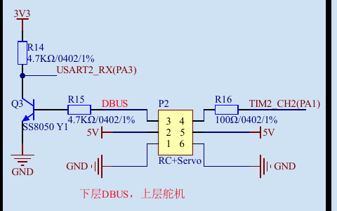

# Cherrycoast4.8.1 与 FS-iA10B 接线

用户最新确认主控是Cherrycoast4.8.1，接收机仍为FS-iA10B，遥控器配置沿用第15项。依据 `03_参考资料/Cherrycoast4.8.1.pdf` 第1/2页，当前固件继续用UART4 / PA1，因此接收机连接到新板 **P2上层三针**。

| FS-iA10B i-BUS SERVO端口 | 新板P2 | 信号去向 |
| --- | --- | --- |
| S，信号 | 上层pin4 | R16 100Ω → PA1；固件配置AF8 / UART4_RX |
| +，电源 | 上层pin5 | 5V |
| −，地 | 上层pin6 | GND |

按端口上的S/+/−及板端针号核对，不按线色或原理图左右方向猜实物朝向。原理图“TIM2_CH2(PA1)”是该导线的网名；PA1也可复用为UART4_RX，当前代码已这样设置，不会输出舵机PWM。接收机使用i-BUS SERVO，不能换到i-BUS SENS接口。

4.8.1的P1已是六个普通GPIO，pin1..6依次PC2、PC9、PB1、PC0、PC1、PC8，没有5V/GND；不要照旧板P1的名称插上接收机。P2下层pin3是经过Q3反相的DBUS，当前富斯i-BUS使用上层非反相信号。板上白色USART4/J7的RX接PC11，现有代码接PA1，因此此次也不使用J7。

## 操作顺序

1. 断电，按上述表将三根线连接到P2上层4/5/6。
2. 保持原对频、通道绑定和Failsafe：CH1=1500、CH5/CH6=1000作为失联输出。首次只给板和接收机逻辑电源，CH5保持OFF。
3. 烧录当前参数采集HEX，USART1继续使用原USB转串口，VOFA 115200 / 8N1 / FireWater。接收机无需使能电机。
4. 检查VOFA下标28（UART4字节）持续增加、下标10（合法帧新鲜度）为1；动原CH1/5/6应改变下标0/4/5。下标12（动力许可）始终为0。
5. 若字节数为0，先查P2上层、S/+/−、供电和共地；若字节增长但新鲜度为0，查是否用SERVO而非SENS、对频、115200 / 8N1，及是否误接反相DBUS。

MCU仍是STM32F405RGT6，晶振25MHz，USART1与双CAN引脚与现有采集工程一致，按P2上层接法无需改接收串口引脚。已把 `Core/Src/usart.c` 注释和任务16文档更正为P2。当前采集不调用IMU；实际IMU型号/装配仍需后续核对。

确认接收机通信后，关闭VOFA串口，按[USART1电机参数采集步骤](USART1电机参数采集步骤.md)运行采集并保存两份结果。
