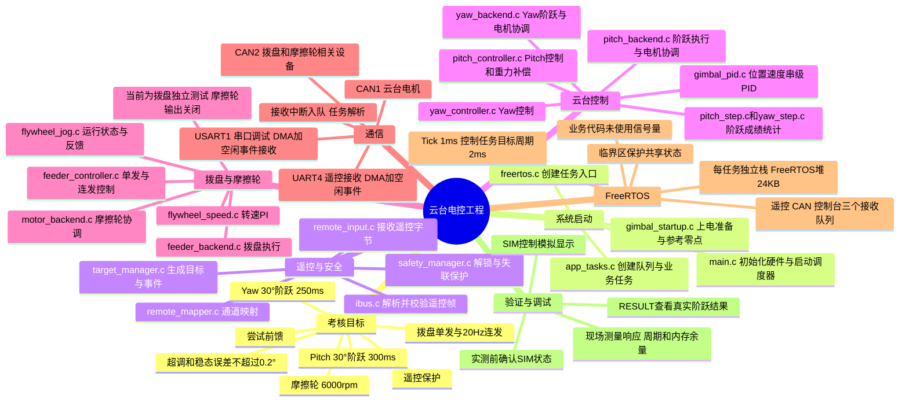

# 云台工程代码思维导图与答辩复习

本文根据当前工程和我们的讨论整理，适合先看整体结构，再沿 Pitch 阶跃主线阅读代码。**配置值是程序中的目标或门限；实际响应、周期和内存余量需要实机测量。**

## 一、工程整体思维导图



## 二、工程主调用链

```text
main → MX_FREERTOS_Init → AppTasks_Create → 任务开始运行
                                               │
遥控输入 → 遥控映射 → 安全判断 → 目标管理 → ControlTask
                                               │
                   电机后端 → 控制器 → 串级 PID → CAN 发送
                       ↑                         │
                       └──── CAN 接收与电机反馈 ←┘
```

任务和中断是并发工作的，上图是数据与调用关系，不代表所有函数从头到尾只顺序执行一次。

## 三、App 文件和关键函数

### 1. system：调度、遥控逻辑和保护

| 文件 | 作用 | 关键函数 |
|---|---|---|
| `system/app_tasks.c` | 创建任务和队列，周期协调各模块。 | `AppTasks_Create()`、`ControlTask()`、`RemoteTask()`、`CanTask()`、`ConsoleTask()` |
| `system/app_logic.c` | 串起遥控映射、安全判断和目标生成。 | `AppLogic_Step()` |
| `system/gimbal_startup.c` | 上电准备、双轴检查与参考零点建立。 | `GimbalStartup_Update()`、`GimbalStartup_OutputReady()` |
| `system/remote_mapper.c` | 把遥控通道值转换成模式、摇杆速度与阶跃方向。 | `RemoteMapper_Map()`、`MapRate()` |
| `system/safety_manager.c` | 失联保护、解锁和动力输出许可。 | `SafetyManager_Step()`、`Lock()` |
| `system/target_manager.c` | 生成手动、阶跃和发射请求。 | `TargetManager_Step()`、`AssessmentStep()`、`RepeatShot()` |
| `system/app_fault.c` | 处理严重系统故障。 | `AppFault_Fatal()` |

### 2. motors：电机功能和控制

`backend` 侧重电机的运行协调、使能和命令提交；`controller` 侧重目标、反馈和控制量计算。

| 文件 | 作用 | 关键函数 |
|---|---|---|
| `motors/pitch_backend.c` | Pitch 阶跃入口、状态管理、反馈和 CAN 提交。 | `PitchBackend_StartStep()`、`PitchBackend_Apply()`、`PitchBackend_OnFrame()` |
| `motors/pitch_controller.c` | Pitch 目标、双环、重力补偿和末段制动。 | `PitchController_StartMove()`、`PitchController_Update()`、`PitchController_OnFeedback()` |
| `motors/yaw_backend.c` | Yaw 相对阶跃、状态管理、反馈和 CAN 提交。 | `YawBackend_StartStep()`、`YawBackend_Apply()`、`YawBackend_OnFrame()` |
| `motors/yaw_controller.c` | Yaw 目标和控制计算。 | `YawController_Update()`、`YawController_OnFeedback()`、`YawController_CaptureReference()` |
| `motors/feeder_backend.c` | 协调拨盘请求、反馈和 CAN 电流输出。 | `FeederBackend_Apply()`、`FeederBackend_OnFrame()` |
| `motors/feeder_controller.c` | 拨盘单发、连发和电流控制。 | `Feeder_Run()`、`Feeder_OnFrame()` |
| `motors/motor_backend.c` | 摩擦轮执行与健康状态协调。 | `MotorBackend_Apply()`、`MotorBackend_OnFrame()`、`MotorBackend_GetHealth()` |
| `motors/flywheel_jog.c` | 摩擦轮运行状态、反馈和电流请求。 | `FlywheelJog_Step()`、`FlywheelJog_OnFrame()`、`FlywheelJog_TakeCommand()` |
| `motors/flywheel_speed.c` | 摩擦轮转速目标和 PI 控制。 | `FlywheelSpeed_Step()`、`FlywheelSpeed_RecordFeedback()` |

### 3. control：共用算法与阶跃统计

| 文件 | 作用 | 关键函数 |
|---|---|---|
| `control/gimbal_pid.c` | Yaw、Pitch 共用的位置—速度串级 PID。 | `GimbalPid_UpdateWithFeedforward()`、`GimbalPid_Observe()` |
| `control/pitch_step.c` | Pitch 真实阶跃记录及 300 ms 判定适配。 | `PitchStep_Start()`、`PitchStep_Sample()` |
| `control/yaw_step.c` | 阶跃公共统计：稳定时间、超调和稳态误差。 | `YawStep_Start()`、`YawStep_Sample()`、`YawStep_Passed()` |

### 4. drivers：通信与协议

| 文件 | 作用 | 关键函数 |
|---|---|---|
| `drivers/can_bus.c` | 双 CAN 启动、接收队列及电机命令发送。 | `CanBus_Start()`、`HAL_CAN_RxFifo0MsgPendingCallback()`、`CanBus_PitchTorque()` |
| `drivers/can_frame.c` | 检查工程内部 CAN 帧的基本有效性。 | `CanFrame_IsValid()` |
| `drivers/dm3507.c` | Pitch 电机协议编码与反馈解码。 | `Dm3507_MakeTorque()`、`Dm3507_Decode()`、`Dm3507_MakeEnable()` |
| `drivers/gl60_ii.c` | Yaw 电机协议编码与反馈解码。 | `Gl60_BuildTorque()`、`Gl60_Decode()`、`Gl60_BuildEnable()` |
| `drivers/ibus.c` | 遥控 iBUS 帧头、校验和与通道解析。 | `ibus_feed_byte()`、`ibus_poll_timeout()` |
| `drivers/remote_input.c` | UART4 遥控接收、队列和有效帧发布。 | `RemoteInput_RxEvent()`、`RemoteInput_Poll()`、`RemoteInput_GetState()` |

### 5. console：串口调试

| 文件 | 作用 | 关键函数 |
|---|---|---|
| `console/app_console.c` | 串口接收、完整命令分发和遥测输出。 | `AppConsole_Poll()`、`HandleLine()`、`HAL_UARTEx_RxEventCallback()` |
| `console/pitch_console.c` | Pitch 阶跃、回零、调参和结果查询命令。 | `PitchConsole_Handle()`、`PitchConsole_Poll()` |
| `console/yaw_console.c` | Yaw 阶跃、回零、调参和结果查询命令。 | `YawConsole_Handle()`、`YawConsole_Poll()` |
| `console/feeder_console.c` | 拨盘命令、状态、参数和遥测。 | `FeederConsole_Handle()`、`FeederConsole_Telemetry()` |

`App/app_config.h` 集中保存周期、超时、角度范围和控制参数等配置。各 `.c` 文件开头还有该文件的函数与文件级变量清单。

## 四、从上电到 Pitch 阶跃

1. **上电初始化**：`main()` 初始化时钟、CAN、串口和 FreeRTOS，启动调度器。
2. **创建任务**：`AppTasks_Create()` 初始化后端，创建遥控、CAN、控制和串口任务。
3. **准备与零点**：在确认过的水平机械基准和安全 OFF 条件下，`GimbalStartup_Update()` 检查反馈并建立软件参考。
4. **遥控解锁**：安全管理器要求有效的新 OFF 帧和满足回中条件的解锁操作；设备和反馈就绪后才允许输出。
5. **生成阶跃请求**：遥控通道选择测试模式和 Pitch 轴，经 `RemoteMapper_Map()`、`TargetManager_Step()` 生成单次事件。串口 `PITCH STEP` 也可进入阶跃后端，但同样受相应条件约束。
6. **启动阶跃**：`PitchBackend_StartStep()` 检查零点、在线、使能、静止和正在测量等条件，随后调用 `PitchController_StartMove()` 和 `PitchStep_Start()`。
7. **设置目标**：控制器直接给定目标角度，计算 `目标角度 - 实际角度`。
8. **计算力矩**：位置 PID 输出目标角速度；速度 PID 根据速度误差计算力矩，并加入重力补偿和末段制动，最后限幅。
9. **发送与反馈**：`CanBus_PitchTorque()` 提交力矩帧；CAN 反馈经 `PitchBackend_OnFrame()` 更新实际角度和速度，进入下一轮计算。
10. **统计成绩**：`PitchStep_Sample()` 使用真实反馈统计稳定时间、超调和稳态误差，结果可通过 `PITCH RESULT` 查询。

Pitch 阶跃参数在该入口中是**软件坐标下的绝对目标**。当前目标范围为 −18°～+33°，因此 −30° 会被拒绝。

## 五、队列、串口和 CAN

| 队列 | 队列项与容量 | 生产者 | 消费者 |
|---|---|---|---|
| 遥控接收 | 256 项带时间与故障代次的字节 | UART 接收回调 | `RemoteTask` |
| CAN 接收 | 64 项 `CanFrame` | CAN 接收回调 | `CanTask` |
| 控制台接收 | 128 项带时间与故障代次的字节 | UART 接收回调 | `ConsoleTask` |

中断使用 `xQueueSendFromISR()` 入队，任务通过 `xQueueReceive()` 出队；协议解析主要放在任务中。接收时间用于识别过期数据，队列满也会进入对应故障处理。

当前 App 业务代码没有创建或使用信号量；共享状态通过 `taskENTER_CRITICAL()` / `taskEXIT_CRITICAL()` 等机制协调。队列负责传递数据，临界区用于保护特定共享操作。

| 通信接口 | 工程用途 | 方式 |
|---|---|---|
| UART4 | 遥控器 iBUS | 115200，DMA + 空闲事件接收 |
| USART1 | 电脑命令和遥测 | 921600，DMA + 空闲事件接收；文本在任务中通过 HAL 串口发送 |
| CAN1 | Yaw 和 Pitch 电机 | 控制命令及电机反馈 |
| CAN2 | 拨盘和摩擦轮相关设备 | 控制命令及电机反馈 |

一次 DMA 接收事件不一定刚好是一帧协议数据；iBUS 解析器按字节持续组帧。CAN 发送返回提交成功也不等于电机已经到位，需要依据反馈判断。

## 六、任务栈、堆和周期

### 任务与栈

| 任务 | 原生栈深度 | 当前平台字节数 | 优先级 | 主要作用 |
|---|---:|---:|---:|---|
| `RemoteTask` | 384 个字 | 1536 | 4 | 遥控解析 |
| `CanTask` | 384 个字 | 1536 | 4 | CAN 接收分发 |
| `ControlTask` | 768 个字 | 3072 | 3 | 安全、目标和电机控制 |
| `ConsoleTask` | 768 个字 | 3072 | 2 | 串口命令与遥测 |
| `defaultTask` | CMSIS 配置 512 字节 | 512 | CMSIS Normal | 默认任务，周期休眠 |

当前 `StackType_t` 为 4 字节；原生 `xTaskCreate()` 的栈深度以该类型为单位，CMSIS `stack_size` 则以字节配置。空闲任务和定时器服务任务另有自己的栈。

FreeRTOS 堆为 24 KB，使用 `heap_4`，动态任务和队列会消耗其中的空间。启动文件还配置了 1024 字节主栈和 512 字节 C 库堆，与各任务栈、FreeRTOS 堆应分开理解。工程启用了任务栈溢出和分配失败钩子；实际余量应在实机复杂场景下测量任务栈高水位和剩余堆。

### 主要周期

| 项目 | 配置或目标 | 说明 |
|---|---:|---|
| FreeRTOS Tick | 1 ms，1000 Hz | 调度时间刻度 |
| 控制任务 | 2 ms，目标 500 Hz | 使用 `vTaskDelayUntil()` |
| 遥控任务 | 2 ms 轮询 | 不代表遥控器实际发帧频率 |
| CAN 任务 | 队列等待参数 2 ms | 有积压时可连续处理帧 |
| Pitch 力矩提交 | 至少间隔 2 ms | 实际发送受调度与总线状态影响 |
| Yaw 力矩提交 | 至少间隔 10 ms | 控制更新与发送周期不同 |
| 串口遥测 | 5 ms 目标周期 | 实际受任务调度和发送耗时影响 |
| 摩擦轮速度控制 | 20 ms | 当前独立拨盘配置下摩擦轮动力输出关闭 |
| 拨盘连发请求 | 50 ms | 对应目标 20 Hz，实际发射能力需实测 |

遥控超时 100 ms、阶跃统计窗口 5 s 和 Pitch 300 ms 考核要求分别是**超时、测量窗口和判据**，不是控制任务周期。工程使用 HAL 的 TIM2 毫秒时间基准处理时间判断；RTOS 也有自己的调度节拍。

## 七、答辩口述主线

> 上电后，系统初始化硬件并启动 FreeRTOS 任务。遥控和 CAN 接收使用中断与队列交接，由任务解析并更新状态。云台在安全 OFF 条件下完成准备和零点建立，操作员解锁后，遥控命令经映射和安全判断形成目标。Pitch 阶跃启动时先检查电机、反馈和静止条件，再直接给定目标角度。控制任务根据真实反馈运行位置—速度串级 PID，叠加重力补偿和末段制动，通过 CAN 向电机发送力矩；电机反馈继续参与闭环和阶跃成绩统计。

**测试展示前**：保留的模拟曲线可能影响显示，实测展示时应确认 `PITCH SIM OFF` / `YAW SIM OFF` 状态；正式控制和 RESULT 使用真实反馈。目标周期、20 Hz 请求节拍和代码中的判据都不能代替现场对电机响应、机械发射效果、实时性及内存余量的测量。
